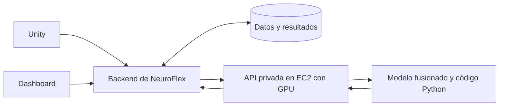

# NeuroFlex: desplegar el modelo fusionado y congelado en AWS

Fecha: 29 de octubre de 2026. Entrega: `neuroflex-scenes-v1-merged-fp16`.

Esta guía explica cómo llevar el ZIP a AWS, ejecutar el modelo y ofrecerlo mediante
una API privada para que lo utilice el backend de NeuroFlex. Los comandos del
servidor están escritos para **Ubuntu Linux con Bash y GPU NVIDIA**.

La fusión y la inferencia ya se comprobaron en Linux local con una RTX 3060.
**El despliegue en AWS y la API de ejemplo de esta guía todavía deben validarse allí.**
No hace falta entrenar ni fusionar otra vez.

## 1. Qué vas a desplegar

El ZIP contiene el modelo base Qwen3-4B y el ajuste QLoRA **ya fusionados**. La base
forma parte de los pesos completos: no se descarga ni se configura por separado.
Tampoco necesitas Ollama, el adaptador original, PEFT ni bitsandbytes para inferir.

| Término | Significado en esta entrega |
|---|---|
| Pesos | Los números que definen el comportamiento aprendido del modelo. Están en `model/model.safetensors`. |
| Modelo fusionado | Los cambios del adaptador se sumaron a los pesos base; se carga un modelo completo. |
| FP16 | Números de punto flotante de 16 bits. Es el formato numérico guardado y usado por este ejecutor. |
| Modelo congelado | Una versión fija de pesos, tokenizer, código y configuración. Inferir no actualiza los pesos. |
| Tokenizer | Convierte texto en tokens que puede procesar el modelo, y viceversa. También hay que desplegarlo. |
| Inferencia | Ejecutar el modelo con una entrada nueva para obtener una respuesta. |
| Runtime | Las librerías y el código que cargan y ejecutan el modelo. Aquí: Python, PyTorch y Transformers. |
| API | Servicio HTTP al que otro programa envía datos y del que recibe resultados. |
| Endpoint | Una ruta concreta de la API, por ejemplo `POST /v1/summaries`. |
| Manifiesto y SHA-256 | Lista de archivos y sus huellas criptográficas. Permiten detectar cambios en la entrega. |

El ZIP es un solo archivo **para transportar**. Después hay que extraerlo y preparar
el runtime. Los pesos por sí solos no calculan las métricas ni aplican el control
de resúmenes: esa parte está en Python y debe conservarse.

### Archivos de esta entrega

En el equipo de origen, desde la raíz del repositorio:

```text
releases-ia/neuroflex-scenes-v1-merged-fp16.zip
releases-ia/neuroflex-scenes-v1-merged-fp16.zip.sha256
```

El ZIP ocupa aproximadamente **6,42 GB**. Incluye:

```text
ENTREGA.md
verificacion-fusion-fp16.json          Evaluación de esta entrega fusionada
verificacion-pesos-fusion.json         Comprobación de la suma base + LoRA
neuroflex-scenes-v1-merged-fp16/
  infer.py                           Entrada CLI; CLI significa línea de comandos
  verify_merged.py                    Verificación de integridad y evaluación
  manifest.json                      Manifiesto del paquete fusionado
  model/
    model.safetensors                Pesos completos, aproximadamente 8 GB
    config.json                      Arquitectura y configuración
    tokenizer.json                   Tokenizer
    tokenizer_config.json
    chat_template.jinja              Formato de los mensajes de conversación
    generation_config.json
    LICENSE
  scenes/                            Inferencia, métricas y control de texto
  evaluation/                        Validadores
  schemas/                           Contratos JSON
  data/                              Ejemplos y corpus sintético
  provenance/                        Procedencia y registros históricos
```

Valores esperados **solo para este ZIP**:

| Archivo | SHA-256 |
|---|---|
| ZIP completo | `2c59d2999bc7a69fff850b71665165fc68f31345079381c034821c015ac1211f` |
| `manifest.json` del fusionado | `49e523f65bf4fcf514f84f855af4bba737f9703436ee40d71cbad476e96988e7` |
| `model/model.safetensors` | `95c8c2b46883e1d84d596ee344598711295fefa54565d1a5034ccdbff56aa3ff` |

No reemplazar estos valores por el hash de cualquier archivo recibido si una
comprobación falla. Investigar la diferencia o usar el registro de otra entrega.

### Qué se comprobó localmente

Los 398 tensores coinciden con el cálculo esperado; 72 matrices incorporan el ajuste.
Los 48 casos de validación y prueba produjeron salidas finales coincidentes con las
referencias. De ellos, **24 resúmenes originales coincidieron directamente y otros
24 fueron sustituidos por el control determinista**. El candidato original NF4
necesitaba 12 sustituciones en total. La nueva configuración cambia respuestas.

Esto es una prueba técnica sobre datos sintéticos. No significa 100 % de exactitud
autónoma del modelo ni validación clínica. El manifiesto se congeló antes de evaluar
y conserva `merged_candidate_pending_evaluation` y `approved_for_deployment: false`;
el informe externo registra la evaluación posterior vinculada a ese manifiesto.
No modificar el manifiesto para cambiar esas etiquetas.

## 2. Arquitectura que vas a construir



**EC2** es un servidor virtual de AWS. Tendrá la GPU y ejecutará la API. **S3** es
almacenamiento de archivos: se usa para transferir y conservar el ZIP, pero guardar
el ZIP en S3 no ejecuta el modelo. **EBS** es el disco persistente conectado a EC2.

El backend recupera las rondas autorizadas de tu base de datos, construye el JSON
de entrada y llama a la API. El modelo no consulta la base de datos por sí mismo.
El dashboard consume resultados a través del backend, que controla los permisos.

Primero dejarás funcionando la inferencia desde terminal. Después agregarás la API,
su arranque automático y la conexión privada. Docker y SageMaker son alternativas
posteriores; no son necesarios para seguir este camino inicial en EC2.

## 3. Crear el servidor EC2

En la consola AWS, selecciona una región y entra a **EC2 → Launch instance**.
Usa la misma región que tu backend y almacenamiento cuando sea posible.

| Opción | Elección para empezar |
|---|---|
| Nombre | `neuroflex-ia-fusionada` |
| AMI | Una AWS Deep Learning AMI Ubuntu, NVIDIA, x86_64, con controlador compatible con el runtime CUDA 13.0 que instalaremos. |
| Tipo de instancia | `g5.2xlarge` como punto de partida para pruebas: una GPU NVIDIA A10G y 32 GiB de RAM. |
| Disco | EBS `gp3`, por ejemplo 80 GiB, cifrado. Da margen para sistema, ZIP, extracción y librerías. |
| Modalidad | On-Demand para la primera puesta en marcha. |
| Red | La VPC del backend, o una red con conectividad privada hacia él. |

Una **AMI** es la imagen inicial del sistema operativo. Las **Deep Learning AMI**
traen componentes para aprendizaje automático; aun así, se debe comprobar la
compatibilidad del controlador con la versión de PyTorch elegida.
[Documentación de DLAMI](https://docs.aws.amazon.com/dlami/latest/devguide/what-is-dlami.html).

`g5.2xlarge` es una propuesta de dimensionamiento, no una medición de este modelo
en AWS. Revisar disponibilidad, cuotas GPU y precio en la región antes de lanzarla.
Los pesos requieren unos 8 GB, pero también hace falta VRAM para activaciones y
caché de generación. **VRAM** es la memoria de la GPU, distinta de la RAM del servidor.
[Especificaciones EC2](https://docs.aws.amazon.com/ec2/latest/instancetypes/ac.html).

### Red y permisos

Una **VPC** es tu red privada en AWS. Un **Security Group** es el conjunto de reglas
que permite conexiones de red a la instancia.

Para la primera prueba, permite SSH, puerto TCP 22, únicamente desde la IP del
administrador. Mantén cerrados al público los puertos 8000 y 8080. Más adelante
habilitarás 8080 exclusivamente desde el backend o desde el balanceador privado.
También puedes administrar una instancia privada mediante Session Manager o EC2
Instance Connect Endpoint si tu organización ya los tiene configurados.
[Conexiones a EC2](https://docs.aws.amazon.com/AWSEC2/latest/UserGuide/connect.html),
[Security Groups](https://docs.aws.amazon.com/AWSEC2/latest/UserGuide/security-group-rules-reference.html).

Si eliges una subred privada, prepara salida a Internet durante la instalación
mediante NAT o el mecanismo de tu organización. Un endpoint de S3 por sí solo no
permite descargar paquetes de PyPI o PyTorch. La inferencia posterior carga pesos locales.

Asocia a EC2 un **rol IAM**, es decir, una identidad con permisos para servicios AWS.
Para descargar el ZIP basta permitir `s3:GetObject` sobre su objeto o prefijo concreto;
si usas cifrado SSE-KMS, también hacen falta los permisos KMS correspondientes.
No requiere acceso general a todos los datos de participantes.
[Roles IAM para EC2](https://docs.aws.amazon.com/IAM/latest/UserGuide/id_roles_use_switch-role-ec2.html).

## 4. Subir el ZIP y conectarte al servidor

### En el equipo de origen

Crea un bucket S3 privado con **Block Public Access** activado. Un **bucket** es el
contenedor de objetos de S3. Usa un prefijo versionado, por ejemplo:

```text
s3://TU_BUCKET/releases/neuroflex-scenes-v1-merged-fp16.zip
```

Sube el ZIP desde la consola S3 o, si tienes AWS CLI instalada y autenticada:

```bash
aws s3 cp releases-ia/neuroflex-scenes-v1-merged-fp16.zip \
  s3://TU_BUCKET/releases/neuroflex-scenes-v1-merged-fp16.zip
```

`TU_BUCKET` es un marcador: reemplázalo por tu bucket real. **AWS CLI** es la
herramienta de terminal para operar AWS. Para autenticarse, usa el mecanismo de tu
organización, por ejemplo IAM Identity Center/SSO; EC2 utilizará su rol IAM.
[Subir objetos a S3](https://docs.aws.amazon.com/AmazonS3/latest/userguide/upload-objects.html),
[comando `aws s3 cp`](https://docs.aws.amazon.com/cli/latest/reference/s3/cp.html).

Conéctate por SSH usando el usuario indicado por la AMI. En Ubuntu normalmente es
`ubuntu`. Con una instancia que tenga IP pública y tu regla SSH restringida:

```bash
chmod 400 neuroflex.pem
ssh -i neuroflex.pem ubuntu@IP_PUBLICA_EC2
```

`neuroflex.pem` es tu clave privada de conexión. No forma parte de la entrega.
Una instancia privada se conecta mediante el mecanismo privado que hayas configurado.

### A partir de aquí: en la terminal de EC2

Verifica primero la GPU:

```bash
nvidia-smi
```

Debes ver el nombre de la GPU y el controlador. Si falla, resolver la AMI/controlador
antes de instalar y ejecutar el modelo. El campo CUDA de `nvidia-smi` indica una
capacidad del controlador; la comprobación decisiva del runtime será con PyTorch.

Prepara las carpetas, con tu usuario de administración actual:

```bash
sudo mkdir -p /opt/neuroflex
sudo chown "$(id -un):$(id -gn)" /opt/neuroflex
mkdir -p /opt/neuroflex/{downloads,releases,service,reports}
sudo apt-get update
sudo apt-get install -y python3-venv unzip curl ca-certificates nginx
```

Instala AWS CLI v2 si `aws --version` no funciona, siguiendo su
[instalador oficial para Linux x86_64](https://docs.aws.amazon.com/cli/latest/userguide/getting-started-install.html).
Descarga y comprueba el ZIP:

```bash
aws s3 cp s3://TU_BUCKET/releases/neuroflex-scenes-v1-merged-fp16.zip \
  /opt/neuroflex/downloads/neuroflex-scenes-v1-merged-fp16.zip
cd /opt/neuroflex/downloads
echo '2c59d2999bc7a69fff850b71665165fc68f31345079381c034821c015ac1211f  neuroflex-scenes-v1-merged-fp16.zip' | sha256sum -c -
```

Resultado esperado: `neuroflex-scenes-v1-merged-fp16.zip: OK`. Luego extrae:

```bash
unzip /opt/neuroflex/downloads/neuroflex-scenes-v1-merged-fp16.zip \
  -d /opt/neuroflex/releases
```

La carpeta del paquete será:

```text
/opt/neuroflex/releases/neuroflex-scenes-v1-merged-fp16
```

Los informes externos y `ENTREGA.md` quedan un nivel más arriba. No edites archivos
del paquete. La API y su entorno vivirán fuera de él.

## 5. Instalar el entorno de inferencia

Un **entorno virtual** aísla las dependencias Python del servicio. El entorno local
comprobado usó Python 3.14.8 y PyTorch `2.14.1+cu130`. `cu130` identifica la variante
con CUDA 13.0; una variante `+cpu` no permite ejecutar este runtime en GPU.

Ubuntu puede traer otro Python. Usaremos **uv**, una herramienta que instala
versiones de Python y crea entornos sin reemplazar el Python del sistema:

```bash
python3 -m venv /opt/neuroflex/tools
/opt/neuroflex/tools/bin/python -m pip install uv
export UV_PYTHON_INSTALL_DIR=/opt/neuroflex/python
/opt/neuroflex/tools/bin/uv python install 3.14.8
/opt/neuroflex/tools/bin/uv venv --python 3.14.8 /opt/neuroflex/venv
/opt/neuroflex/tools/bin/uv pip install \
  --python /opt/neuroflex/venv/bin/python \
  'torch==2.14.1+cu130' --index-url https://download.pytorch.org/whl/cu130
/opt/neuroflex/tools/bin/uv pip install \
  --python /opt/neuroflex/venv/bin/python \
  'transformers==5.20.2' 'accelerate==1.15.0' 'safetensors==0.8.0'
```

Se fija Python en `/opt/neuroflex/python` para que el servicio pueda usarlo sin
depender del directorio personal del administrador.
[Gestión de Python con uv](https://docs.astral.sh/uv/guides/install-python/).

No instales a ciegas `requirements-lock.txt`: conserva el entorno original de
Windows, con componentes del entrenamiento. El registro Linux de exportación
está en `provenance/export_environment.json`. Los comandos de arriba fijan las
dependencias principales; al final se guardará el conjunto realmente instalado.
Si alguna versión no tiene un paquete compatible con la AMI elegida, resolver esa
compatibilidad y registrar otro entorno; no sustituir versiones silenciosamente.

Comprueba instalación y acceso real a GPU:

```bash
/opt/neuroflex/tools/bin/uv pip check --python /opt/neuroflex/venv/bin/python
/opt/neuroflex/venv/bin/python - <<'PY'
import torch
print('PyTorch:', torch.__version__)
print('CUDA del runtime:', torch.version.cuda)
assert torch.cuda.is_available(), 'PyTorch no puede acceder a CUDA'
print('GPU:', torch.cuda.get_device_name(0))
print('Operación GPU:', torch.ones(1, device='cuda').item())
PY
```

La última salida debe ser `1.0`. Este paso detecta diferencias entre tener
`nvidia-smi` funcionando y tener PyTorch realmente operativo con CUDA.

## 6. Probar el paquete antes de crear la API

```bash
cd /opt/neuroflex/releases/neuroflex-scenes-v1-merged-fp16
sha256sum manifest.json
/opt/neuroflex/venv/bin/python -B infer.py \
  --input data/scenes_v1_1/example_request.json
```

El hash debe coincidir con la tabla inicial. El ejecutor comprueba los archivos
del manifiesto, carga el modelo local y devuelve JSON de Puzzle, Memoria y Palomas.
No usa `--cache-dir`, `HF_HOME` ni una descarga de Hugging Face para cargar la base.

Revisa `metrics`, `resumen`, `warnings` y `summarySource` en cada ronda. Valores de
`summarySource`:

| Valor | Interpretación |
|---|---|
| `model_verified_template` | Se conservó el texto generado porque coincide con la referencia del control. |
| `deterministic_fallback` | El control sustituyó el texto por una descripción calculada. |
| `deterministic_preview` | Se ejecutó una vista previa sin cargar IA. |

Si solo quieres comprobar el contrato y la extracción sin cargar GPU, añade
`--preview`. Para evaluar el modelo real en AWS:

```bash
/opt/neuroflex/venv/bin/python -B verify_merged.py \
  --output /opt/neuroflex/reports/verificacion-aws-01.json
```

El informe debe terminar con `status: completed`. Revisa los conteos de ambos
conjuntos y compáralos con el informe local incluido en el ZIP. El verificador
rechaza sobrescribir informes: usa otro nombre si repites la prueba. Guarda el
informe fuera del paquete. Un resultado diferente requiere investigar entorno,
hardware y respuestas; no dar por equivalente cualquier salida final sustituida.

## 7. Crear una API que cargue el modelo una sola vez

**FastAPI** define las rutas HTTP. **Uvicorn** es el servidor ASGI que ejecuta
FastAPI. **Lifespan** es la fase de inicio/cierre de la aplicación: aquí permite
cargar el modelo antes de recibir peticiones y reutilizarlo.
[Lifespan en FastAPI](https://fastapi.tiangolo.com/advanced/events/).

Instala las dependencias adicionales y registra el entorno:

```bash
/opt/neuroflex/tools/bin/uv pip install \
  --python /opt/neuroflex/venv/bin/python fastapi uvicorn
/opt/neuroflex/tools/bin/uv pip check --python /opt/neuroflex/venv/bin/python
/opt/neuroflex/tools/bin/uv pip freeze --python /opt/neuroflex/venv/bin/python \
  > /opt/neuroflex/service/requirements-aws-lock.txt
```

Estas dependencias de API se incorporan en AWS y requieren sus propias pruebas.
Guarda el siguiente código como **`/opt/neuroflex/service/app.py`**:

```python
import hashlib
import hmac
import json
import logging
import os
from pathlib import Path
import sys
import threading
from contextlib import asynccontextmanager

from fastapi import Depends, FastAPI, Header, HTTPException

PACKAGE = Path(os.environ['NEUROFLEX_PACKAGE']).resolve()
EXPECTED_MANIFEST = os.environ['NEUROFLEX_MANIFEST_SHA256']
TOKEN = os.environ['NEUROFLEX_INTERNAL_TOKEN']
VERSION = 'neuroflex-scenes-v1-merged-fp16'
if len(TOKEN) < 32:
    raise RuntimeError('Configurar un token interno de al menos 32 caracteres')
GPU_LOCK = threading.Lock()
log = logging.getLogger('neuroflex')


def sha(path):
    digest = hashlib.sha256()
    with path.open('rb') as stream:
        for block in iter(lambda: stream.read(8 * 1024 * 1024), b''):
            digest.update(block)
    return digest.hexdigest()


def authorize(authorization: str = Header(default='')):
    expected = ('Bearer ' + TOKEN).encode('utf-8')
    if not hmac.compare_digest(authorization.encode('utf-8'), expected):
        raise HTTPException(status_code=401, detail='No autorizado')


@asynccontextmanager
async def lifespan(app: FastAPI):
    if sha(PACKAGE / 'manifest.json') != EXPECTED_MANIFEST:
        raise RuntimeError('El manifiesto no corresponde a la entrega esperada')
    sys.path.insert(0, str(PACKAGE))
    from verify_merged import verify_package
    verify_package(PACKAGE)
    from scenes.contracts import process
    from scenes.runtime import Generator
    from scenes.summaries import response
    app.state.process = process
    app.state.response = response
    app.state.generator = Generator(PACKAGE / 'model')
    yield
    app.state.generator = None


app = FastAPI(lifespan=lifespan)


@app.get('/health')
def health():
    return {'status': 'ready', 'modelVersion': VERSION}


@app.post('/v1/summaries', dependencies=[Depends(authorize)])
def summarize(payload: dict):
    try:
        app.state.process(payload)
    except (ValueError, TypeError, OverflowError) as exc:
        raise HTTPException(status_code=422, detail=str(exc)) from exc
    if len(payload['rounds']) != 1:
        raise HTTPException(status_code=422, detail='Enviar una ronda por petición')
    if not GPU_LOCK.acquire(blocking=False):
        raise HTTPException(status_code=503, detail='Modelo ocupado',
                            headers={'Retry-After': '5'})
    try:
        result = app.state.response(payload, app.state.generator)
        return {'modelVersion': VERSION, 'manifestSha256': EXPECTED_MANIFEST,
                'result': result}
    except Exception:
        log.error('Fallo de inferencia; revisar el servidor')
        raise HTTPException(status_code=500, detail='No se pudo generar el resumen')
    finally:
        GPU_LOCK.release()
```

El **lock** permite una sola inferencia simultánea. Si llega otra, devuelve 503;
no hay una cola persistente dentro de este ejemplo. La restricción de una ronda
es una decisión de la API inicial, aunque el contrato general admita varias.
`/health` queda sin token para comprobaciones de salud dentro de la red privada;
no devuelve datos de participantes y solo responde cuando terminó el arranque.

## 8. Configurar el token y probar HTTP

Un **Bearer token** es un secreto que el backend presenta en la cabecera
`Authorization`. Es una credencial entre servicios, no el inicio de sesión del
usuario del dashboard.

En la terminal de EC2, genera y conserva un token para la prueba:

```bash
export NEUROFLEX_PACKAGE=/opt/neuroflex/releases/neuroflex-scenes-v1-merged-fp16
export NEUROFLEX_MANIFEST_SHA256=49e523f65bf4fcf514f84f855af4bba737f9703436ee40d71cbad476e96988e7
export NEUROFLEX_INTERNAL_TOKEN=$(/opt/neuroflex/venv/bin/python -c 'import secrets; print(secrets.token_urlsafe(32))')
export HF_HUB_OFFLINE=1
export PYTHONDONTWRITEBYTECODE=1
umask 077
mkdir -p /opt/neuroflex/private
cat > /opt/neuroflex/private/service.env <<EOF
NEUROFLEX_PACKAGE=$NEUROFLEX_PACKAGE
NEUROFLEX_MANIFEST_SHA256=$NEUROFLEX_MANIFEST_SHA256
NEUROFLEX_INTERNAL_TOKEN=$NEUROFLEX_INTERNAL_TOKEN
HF_HUB_OFFLINE=1
PYTHONDONTWRITEBYTECODE=1
EOF
```

Este archivo contiene el secreto: conservarlo fuera del ZIP y de Git. En el
despliegue de tu organización puede suministrarse desde Secrets Manager o
Parameter Store. El archivo protegido de esta guía es el mecanismo inicial.

Arranca en primer plano:

```bash
cd /opt/neuroflex/service
/opt/neuroflex/venv/bin/python -m uvicorn app:app \
  --host 127.0.0.1 --port 8000 --workers 1
```

Espera `Application startup complete`. El primer inicio incluye verificar unos
8 GB de pesos. Usa **un worker**, es decir, un proceso servidor: varios workers
cargarían varias copias del modelo. No uses `--reload` para este servicio.

En otra terminal SSH del mismo EC2, carga las variables existentes y prueba:

```bash
set -a
. /opt/neuroflex/private/service.env
set +a
curl --fail-with-body http://127.0.0.1:8000/health
/opt/neuroflex/venv/bin/python - <<'PY'
import json
from pathlib import Path
p = Path('/opt/neuroflex/releases/neuroflex-scenes-v1-merged-fp16/data/scenes_v1_1/example_request.json')
payload = json.loads(p.read_text())
payload['rounds'] = payload['rounds'][:1]
Path('/opt/neuroflex/reports/request-one-round.json').write_text(json.dumps(payload))
PY
curl --fail-with-body --max-time 180 \
  -H "Authorization: Bearer $NEUROFLEX_INTERNAL_TOKEN" \
  -H 'Content-Type: application/json' \
  --data-binary @/opt/neuroflex/reports/request-one-round.json \
  http://127.0.0.1:8000/v1/summaries
```

Debes obtener HTTP 200 con `modelVersion`, `manifestSha256` y `result`. A diferencia
del CLI, la respuesta HTTP envuelve las rondas bajo `result`.

| Código HTTP | Significado y acción |
|---|---|
| 200 | Solicitud procesada. Guardar el resultado y su procedencia. |
| 401 | Falta el token o no coincide. Revisar configuración del backend. |
| 422 | JSON inválido para el contrato o más de una ronda. Corregir la entrada. |
| 503 | GPU ocupada. Reintentar con límite o usar una cola de trabajos. |
| 500 | Fallo de ejecución. Investigar; no guardarlo como análisis válido. |

Comprueba también una petición sin token y una entrada inválida. Finalizada la
prueba, detén el servidor en primer plano con Ctrl+C antes del siguiente paso.

## 9. Mantener el servicio funcionando con systemd

**systemd** administra servicios Linux: arranca la API al encender EC2, conserva
registros y puede reiniciarla si el proceso falla. No reemplaza las pruebas de salud.

Crea el usuario de servicio y entrega el archivo de configuración a root:

```bash
sudo useradd --system --create-home --home-dir /var/lib/neuroflex \
  --shell /usr/sbin/nologin neuroflex
sudo install -d -m 700 /etc/neuroflex
sudo install -m 600 /opt/neuroflex/private/service.env /etc/neuroflex/service.env
sudo chmod 755 /opt/neuroflex/service
sudo chmod 644 /opt/neuroflex/service/app.py
sudo chmod -R a+rX /opt/neuroflex/releases/neuroflex-scenes-v1-merged-fp16
```

Si el usuario ya existe, reutilízalo. `umask 077` protegió los archivos nuevos en la
terminal anterior; por eso se ajusta aquí la lectura del código. Verifica que el
usuario de servicio también pueda recorrer el entorno y Python:

```bash
sudo -u neuroflex /opt/neuroflex/venv/bin/python -c 'import torch, transformers; print(torch.__version__)'
```

Si aparece `Permission denied`, revisa los permisos de los directorios de
`/opt/neuroflex/python`, `venv` y sus padres. Las bibliotecas y el modelo son
legibles; el archivo de secretos permanece con modo 600 y lo lee systemd como root.

Guarda este archivo como **`/etc/systemd/system/neuroflex-ia.service`**, usando
`sudo nano` u otro editor con privilegios:

```ini
[Unit]
Description=NeuroFlex - inferencia del modelo fusionado
After=network-online.target
Wants=network-online.target
StartLimitIntervalSec=300
StartLimitBurst=3

[Service]
Type=simple
User=neuroflex
Group=neuroflex
WorkingDirectory=/opt/neuroflex/service
EnvironmentFile=/etc/neuroflex/service.env
ExecStart=/opt/neuroflex/venv/bin/python -m uvicorn app:app --host 127.0.0.1 --port 8000 --workers 1
Restart=on-failure
RestartSec=10
TimeoutStopSec=180
NoNewPrivileges=true
UMask=0077

[Install]
WantedBy=multi-user.target
```

Activa y comprueba:

```bash
sudo systemctl daemon-reload
sudo systemctl enable --now neuroflex-ia
sudo systemctl status neuroflex-ia --no-pager
sudo journalctl -u neuroflex-ia -n 80 --no-pager
curl --fail-with-body http://127.0.0.1:8000/health
```

`active (running)` por sí solo no garantiza que el modelo haya terminado de cargar:
espera también el mensaje de inicio y HTTP 200 en `/health`. Los registros de
`journalctl` permiten investigar errores. Evita registrar cuerpos completos con
datos de participantes. Después de reiniciar EC2, vuelve a comprobar salud y GPU.

## 10. Conectar la API al backend por la red privada

Hasta aquí, `127.0.0.1` significa que solo EC2 puede llamar a Uvicorn. Añadiremos
**Nginx**, un proxy inverso: recibe las solicitudes de red y las reenvía a Uvicorn.
También limita el tamaño de las entradas y los tiempos de espera.

Guarda **`/etc/nginx/sites-available/neuroflex-ia`** con este contenido:

```nginx
server {
    listen 8080;
    server_name _;
    client_max_body_size 1m;

    location / {
        proxy_pass http://127.0.0.1:8000;
        proxy_http_version 1.1;
        proxy_set_header Host $host;
        proxy_set_header X-Forwarded-For $proxy_add_x_forwarded_for;
        proxy_connect_timeout 5s;
        proxy_read_timeout 180s;
        proxy_send_timeout 180s;
    }
}
```

Actívalo una vez:

```bash
sudo ln -s /etc/nginx/sites-available/neuroflex-ia /etc/nginx/sites-enabled/neuroflex-ia
sudo nginx -t
sudo systemctl enable --now nginx
sudo systemctl reload nginx
curl --fail-with-body http://127.0.0.1:8080/health
```

Para una prueba con datos sintéticos desde el backend, permite TCP 8080 en el
Security Group de EC2 **solo desde el Security Group del backend**. Usará
`http://IP_PRIVADA_EC2:8080/v1/summaries`, conservando la misma cabecera Bearer.
Este tramo HTTP privado no cifra el tráfico; para uso con datos reales, termina
de configurar HTTPS antes de integrar participantes.

### HTTPS mediante un Application Load Balancer interno

**HTTPS** cifra las solicitudes mediante TLS. Un **ALB** recibe tráfico HTTP/HTTPS
y lo dirige a un **target group**, el conjunto de servidores de destino. Puedes
usarlo aunque inicialmente tengas una sola EC2.

En la consola AWS:

1. En Certificate Manager (**ACM**), solicita o selecciona un certificado válido
   para el dominio que controlarás, por ejemplo `ia.tudominio.cl`, en la región
   del ALB. Completa su validación DNS. Ese nombre es un ejemplo, no un dominio creado.
2. Crea un target group de tipo **Instances**, protocolo HTTP, puerto **8080**,
   en la VPC de EC2. Registra la instancia GPU.
3. Configura health check HTTP en **`/health`**, puerto de tráfico, código esperado
   **200**. Espera que el destino pase a `healthy` cuando el modelo termine de cargar.
4. Crea un ALB de esquema **Internal**, en al menos dos subredes/AZ compatibles
   de la VPC. Una **AZ** es una zona de disponibilidad dentro de la región.
5. Crea su listener **HTTPS 443**, selecciona el certificado ACM y reenvía al
   target group. Ajusta el idle timeout, por ejemplo a 180 s para esta prueba.
6. En el Security Group del ALB, permite 443 solo desde el backend autorizado.
   Permite la salida necesaria del ALB hacia EC2 en 8080.
7. En el Security Group de EC2, permite 8080 solo desde el Security Group del ALB.
   Retira la regla temporal de acceso directo desde el backend si ya no se usa.
8. Configura DNS para que el nombre del certificado resuelva al ALB desde la VPC;
   por ejemplo, un registro Alias de Route 53. Un nombre privado de zona y un
   certificado público requieren planificar también la validación del dominio.
9. Desde el backend, prueba `https://ia.tudominio.cl/health` y después el POST con
   token. El certificado debe coincidir con el nombre usado; no desactives su validación.

El ALB termina TLS: su tramo hacia Nginx sigue siendo HTTP dentro de la VPC. Si tu
política exige cifrado también en ese tramo, configura HTTPS en Nginx y en el
target group. Ajusta los timeouts según la latencia medida; una espera de 180 s es
un límite del ejemplo, no una garantía de duración o de capacidad.
[Crear ALB](https://docs.aws.amazon.com/elasticloadbalancing/latest/application/create-application-load-balancer.html),
[health checks](https://docs.aws.amazon.com/elasticloadbalancing/latest/application/target-group-health-checks.html).

## 11. Integrar datos, backend y dashboard

Guarda en la configuración **del backend** la URL interna de inferencia y el mismo
token. No enviarlos a Unity ni al navegador. El flujo de una ronda es:

1. Unity envía sus métricas al backend. El backend valida usuario, participante y ronda.
2. El backend guarda los datos y recupera la revisión autorizada que va a analizar.
3. Construye el JSON `scenes-v1`. Usa el esquema incluido y el ejemplo del paquete;
   no envíes columnas adicionales de la base de datos ni prompts libres del usuario.
4. Llama a `POST /v1/summaries` con una sola ronda. No interpretes el timeout como
   prueba de que la GPU canceló el trabajo: puede seguir ejecutándolo.
5. Guarda el JSON de respuesta, la revisión de entrada y los identificadores
   `modelVersion`, `manifestSha256` y `summarySource`.
6. El dashboard consulta el resultado guardado al backend. Las cifras vienen de
   `result.rounds[].metrics`; el texto viene de `resumen`. No extraer cifras del texto.

`null` significa dato no disponible, no cero. En Palomas, el tiempo principal
parte al ocultarse las palomas y es tiempo de reloj, con espera y pausas. Conserva
las unidades y etiquetas del [contrato de métricas](metricas_unity.md).

Si hay varias solicitudes o la espera resulta larga, agrega una **cola de trabajos**,
por ejemplo SQS, y un **worker** que procese mensajes y llame a la API. Aquí worker
significa consumidor de trabajos, distinto del proceso worker de Uvicorn. El backend
devuelve un `analysisId` y el dashboard consulta su estado. Guarda trabajos pendientes,
completados y fallidos en almacenamiento persistente. Los reintentos deben ser
acotados e **idempotentes**: repetir una solicitud equivalente no debe crear otro
resultado persistente por accidente. Usa propietario, revisión de entrada y versión
del modelo en la clave de deduplicación.

Para comparar varias rondas, el backend debe validar el conjunto y conservar las
reglas de comparabilidad de `scenes.contracts.process`. No obtiene tendencias del
modelo fusionado simplemente concatenando resúmenes de rondas individuales.

## 12. Operación, actualizaciones y costos

Comandos de operación:

```bash
sudo systemctl restart neuroflex-ia
sudo journalctl -u neuroflex-ia -f
nvidia-smi
df -h /opt/neuroflex
```

Mide latencia, fallos, ocupación de GPU, memoria y porcentaje de sustituciones.
CloudWatch es el servicio AWS para métricas y logs; las métricas GPU requieren
configurar su recolección, no aparecen todas automáticamente. El estado `ready`
comprueba disponibilidad inicial, no calidad de los resúmenes.

Una nueva versión se extrae en otra carpeta, se verifica y se evalúa antes de
actualizar `NEUROFLEX_PACKAGE`, `NEUROFLEX_MANIFEST_SHA256` y la versión devuelta por
la API. Conserva la entrega anterior para **rollback**, es decir, volver a la
versión previa si algo falla. No reescribas pesos o prompts de la carpeta congelada.

EC2 con GPU genera costos aunque el modelo esté esperando solicitudes. Para
pruebas, detén la instancia desde la consola AWS cuando no la necesites. Un EC2
detenido conserva cargos de almacenamiento EBS; ALB, S3 y otros recursos también
tienen costos independientes. Detener es distinto de **terminar** la instancia:
terminarla puede borrar volúmenes según `Delete on termination`.
[Detener e iniciar EC2](https://docs.aws.amazon.com/AWSEC2/latest/UserGuide/Stop_Start.html),
[costos durante detención](https://docs.aws.amazon.com/AWSEC2/latest/UserGuide/how-ec2-instance-stop-start-works.html).

Con AWS operativo, tu computador local puede estar apagado. Recibir nuevos datos
no reentrena ni modifica el modelo congelado.

## 13. Problemas frecuentes

| Síntoma | Qué revisar |
|---|---|
| `nvidia-smi` falla | Instancia NVIDIA, AMI y controlador. Instalar PyTorch no arregla por sí solo el controlador del sistema. |
| PyTorch muestra `+cpu` | Se instaló la variante incorrecta. Usar la variante CUDA indicada y repetir la operación GPU de prueba. |
| CUDA no disponible o error de kernel | Compatibilidad del controlador, wheel PyTorch y arquitectura de GPU. Resolver antes de inferir. |
| `CUDA out of memory` | Otros procesos en GPU, workers duplicados o falta de VRAM. Ver `nvidia-smi`; mantener un worker e inferencia serial. |
| Hash incorrecto | ZIP equivocado, transferencia incompleta o archivos cambiados. Recuperar la entrega esperada sin regenerar hashes para aceptarla. |
| Intenta buscar `adapter/` o pide `--cache-dir` | Se está ejecutando el paquete antiguo o `scenes/infer.py` heredado. Usar el `infer.py` de la raíz del fusionado y su `scenes.runtime`. |
| 401 | Token ausente o diferente entre backend y API. No generar otro para el cliente. |
| 422 | Contrato, tipos JSON, campos o número de rondas incorrectos. Comparar con los ejemplos. |
| 413 | Nginx rechazó un cuerpo mayor al límite configurado. Revisar qué datos está enviando el backend. |
| 503 | Hay otra inferencia. Reintentos limitados o cola; no duplicar workers para resolverlo. |
| 502/504 o target `unhealthy` | Servicio no listo, puerto, reglas de red, target group o timeout. Probar `/health` primero en 8000, luego en 8080 y finalmente desde el backend. |
| Funciona por SSH pero falla en systemd | Usuario, permisos de lectura/ejecución, rutas absolutas y archivo de variables. Revisar `journalctl`. |
| `Address already in use` | Sigue abierto Uvicorn en primer plano o hay otro servicio usando el puerto. Detener el proceso de prueba antes de systemd. |
| Aparece `deterministic_preview` | Se ejecutó sin IA. No guardarlo como análisis del modelo. |

## 14. Comprobación final de la integración

- [ ] ZIP y manifiesto coinciden con las huellas de esta entrega.
- [ ] PyTorch ejecuta una operación real en la GPU de EC2.
- [ ] Se ejecutaron el ejemplo y los 48 casos en AWS; se guardó y revisó el informe.
- [ ] La API devuelve 200, 401 y 422 en sus casos correspondientes.
- [ ] La concurrencia devuelve 503 o se gestiona mediante cola sin duplicar resultados.
- [ ] systemd inicia el servicio y la comprobación de salud funciona tras reiniciar EC2.
- [ ] Backend y API se comunican por el acceso privado previsto, con token y HTTPS para datos reales.
- [ ] El dashboard muestra resultados guardados y conserva métricas, advertencias y procedencia.
- [ ] Se registraron AMI, tipo de instancia, dependencias, versión del servicio y hash del modelo.
- [ ] Se midieron latencia, memoria y sustituciones; existe un procedimiento de rollback.

La [guía anterior](guia_integracion_api_dashboard_aws.md) sigue siendo referencia
para el contrato general del backend y el dashboard. Sus pasos de descarga de la
base, caché y carga de adaptadores corresponden al candidato antiguo; para esta
entrega sigue el procedimiento de este documento.
