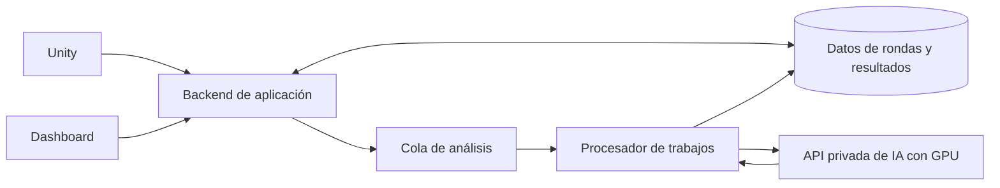

# Guía de entrega e integración: modelo, API, nube y dashboard

Fecha: 21 de octubre de 2026. Destinatario: persona responsable del backend, dashboard y despliegue AWS.

Para entregar base y adaptador fusionados en un único ZIP, ver
[exportación del modelo fusionado](fusion_modelo.md). Es una entrega nueva que
incluye la base y requiere su propia evaluación; los pasos de esta guía describen
el candidato original con base separada.

Para desplegar la entrega fusionada ya generada, seguir la
[guía AWS del modelo fusionado](guia_aws_modelo_fusionado.md), con comandos Linux,
API privada y comprobaciones específicas de esa versión.

## 1. Qué está hecho y qué debe implementarse

El candidato actual utiliza **Qwen3-4B con un adaptador QLoRA entrenado para Puzzle, Memoria y Palomas**. El prototipo Ollama 8B es anterior y no es la entrega que se integra aquí.

| Componente | Estado |
|---|---|
| Modelo entrenado y paquete congelado | Disponible y probado localmente con GPU |
| Validación, cálculo de métricas y resúmenes | Implementados en `scenes` |
| Contratos JSON y ejemplos | Incluidos en el paquete |
| API HTTP | Pendiente; esta guía proporciona un ejemplo para desarrollar fuera del paquete |
| Base de datos, lectura de datos de nube y trabajos asíncronos | A implementar por el integrador |
| Dashboard y conexión Unity | A implementar en sus respectivos proyectos |
| Despliegue AWS | Pendiente; no se ha comprobado en Linux/AWS |

Esta guía no instala ni despliega infraestructura. El ejemplo de API es una base de integración, no un servicio ya desplegado o validado para producción.

El procesamiento completo debe conservarse: el modelo genera texto, Python calcula las métricas y un control sustituye resúmenes que no coinciden con la descripción verificable. `summarySource` distingue cada caso. En la prueba reservada, 18/24 respuestas originales del adaptador coincidieron con las referencias; otras 6 fueron sustituidas. No presentar el resultado posterior al control como exactitud autónoma del modelo.

## 2. Archivos que se entregan

Entregar la carpeta completa, preferiblemente comprimida:

```text
D:\NeuroFlex\releases\neuroflex-scenes-v1-candidate
```

Contiene:

```text
infer.py                         Ejecutor de prueba
manifest.json                    Hashes de los archivos congelados
model/adapter/                   Pesos entrenados y configuración LoRA
model/tokenizer/                 Tokenizer
model/run.json                   Registro y revisión exacta de la base
scenes/                         Contrato, cálculo, generación y control
evaluation/contracts.py          Validador utilizado por scenes
schemas/                        Esquemas de entrada y salida
data/scenes_v1_1/                Ejemplos y corpus de evaluación
data/sft_scenes_v1_1/            Datos del entrenamiento
requirements-lock.txt           Versiones del entorno de inferencia
metricas_unity.md                Diccionario completo de datos
model_card.md                    Resultados y limitaciones
validation.json, test.json       Evaluación del candidato
README.md                       Instrucciones del paquete
```

La **base no está incluida**. Debe obtenerse por separado:

- Repositorio: `Qwen/Qwen3-4B`.
- Revisión exacta: `1cfa9a7208912126459214e8b04321603b3df60c`.
- El adaptador necesita esta base; no funciona por sí solo ni con el modelo Ollama 8B.

Puede darse acceso al repositorio para colaborar, pero los pesos del HDD no se transfieren por compartir el Git. No enviar `.venv-training` ni configuraciones/credenciales personales. No editar los archivos congelados: la API y su entorno deben vivir en otra carpeta.

## 3. Preparar un equipo de prueba

Requisitos del camino probado: Windows, Python 3.14 y GPU NVIDIA con controlador compatible con PyTorch CUDA 13.0. Se comprobó con RTX 3060 de 12 GB; esto no establece un requisito mínimo ni capacidad de concurrencia. La implementación actual no tiene ruta de ejecución CPU.

Reservar espacio suficiente para la base de varios GB, el entorno Python y las descargas temporales. Ubicar la caché explícitamente en la unidad elegida. No iniciar descargas duplicadas en distintas cachés.

Ejemplo de organización en el equipo receptor; adaptar las rutas si no tiene unidad D:

```text
D:\NeuroFlex\
  releases\neuroflex-scenes-v1-candidate\  Paquete recibido
  cache-training\                         Base de Hugging Face
  service\                                Código nuevo de la API
  env\                                    Entorno Python nuevo
```

Desde PowerShell, dentro del paquete recibido:

```powershell
cd D:\NeuroFlex\releases\neuroflex-scenes-v1-candidate
py -3.14 -m venv D:\NeuroFlex\env
D:\NeuroFlex\env\Scripts\python.exe -m pip install torch==2.14.1+cu130 --index-url https://download.pytorch.org/whl/cu130
D:\NeuroFlex\env\Scripts\python.exe -m pip install -r requirements-lock.txt
D:\NeuroFlex\env\Scripts\python.exe -m pip check
D:\NeuroFlex\env\Scripts\python.exe -c "import torch; print(torch.cuda.is_available())"
```

La última instrucción debe imprimir `True`. Si falla la instalación o CUDA no está disponible, resolver versiones/controlador antes de inferir; no sustituir silenciosamente paquetes fijados por versiones distintas. En Linux/AWS hay que verificar que existan paquetes compatibles y probar la imagen resultante. Si se cambia el entorno, registrar otra versión de despliegue y repetir la evaluación. [Verificación de CUDA en PyTorch](https://docs.pytorch.org/docs/stable/generated/torch.cuda.is_available).

## 4. Obtener la base exacta

Si se entrega la caché completa existente, conservar su estructura, incluyendo `hub`, `blobs` y `snapshots`. No mover solo un archivo de pesos ni usar un archivo GGUF/Ollama como sustituto.

Si necesita descargarla, en una terminal con acceso a Internet:

```powershell
$env:HF_HOME = "D:\NeuroFlex\cache-training"
D:\NeuroFlex\env\Scripts\python.exe -c "from huggingface_hub import snapshot_download; snapshot_download(repo_id='Qwen/Qwen3-4B', revision='1cfa9a7208912126459214e8b04321603b3df60c')"
```

`HF_HOME` es la raíz de caché; el modelo queda normalmente en su subcarpeta `hub`. `--cache-dir` de nuestro ejecutor recibe **esa raíz HF_HOME**, no la carpeta de un snapshot. La descarga debe hacerse antes de inferir porque el ejecutor carga exclusivamente archivos locales. [Descarga y caché de Hugging Face](https://huggingface.co/docs/huggingface_hub/main/guides/download).

## 5. Probar el paquete sin API

Desde la carpeta del paquete:

```powershell
D:\NeuroFlex\env\Scripts\python.exe -B infer.py --input data/scenes_v1_1/example_request.json --cache-dir D:\NeuroFlex\cache-training
```

Esto verifica el manifiesto, carga base y adaptador, procesa una ronda por escena y escribe la respuesta JSON en stdout. Las advertencias de librerías y el progreso pueden aparecer en stderr. No hay que fusionar pesos manualmente ni ejecutar entrenamiento.

Para comprobar únicamente el contrato sin GPU/modelo:

```powershell
D:\NeuroFlex\env\Scripts\python.exe -B infer.py --preview --input data/scenes_v1_1/example_request.json
```

La vista previa produce `summarySource = deterministic_preview`: **no es una prueba de IA**.

Revisar:

- Los `roundId` y `sessionId` corresponden a las entradas.
- Las rondas incompletas no reciben tiempo de resolución.
- Memoria sin intentos devuelve precisión `null`, no 0 %.
- En Palomas, `responseTimeSeconds` parte desde ocultación e incluye espera/pausas; `enabledResponseActiveSeconds` es activo desde habilitación.
- El JSON tiene `metrics`, `resumen`, `warnings` y `summarySource` por ronda.

Contrato completo: [metricas_unity.md](metricas_unity.md). Una respuesta de ejemplo está en `data/scenes_v1_1/example_response.json` del paquete.

## 6. Crear un servicio HTTP fuera del paquete

El servicio debe cargar el modelo una vez al arrancar y reutilizarlo. FastAPI permite hacerlo con `lifespan`; no crear un `Generator` por petición. [Documentación de FastAPI](https://fastapi.tiangolo.com/advanced/events/).

Crear `D:\NeuroFlex\service` e instalar las dependencias adicionales de la API en el entorno de trabajo:

```powershell
New-Item -ItemType Directory -Force D:\NeuroFlex\service
D:\NeuroFlex\env\Scripts\python.exe -m pip install fastapi uvicorn
D:\NeuroFlex\env\Scripts\python.exe -m pip check
D:\NeuroFlex\env\Scripts\python.exe -m pip freeze | Set-Content -Encoding utf8 D:\NeuroFlex\service\requirements-api-lock.txt
```

FastAPI/Uvicorn no forman parte del entorno congelado probado. Registrar y probar sus versiones y conservar ese lock como parte del despliegue. No sobrescribir el lock del paquete.

Guardar el siguiente ejemplo como `D:\NeuroFlex\service\app.py`. Es un **servicio interno de una ronda por petición**, con autenticación entre servicios y una inferencia simultánea. No incluye base de datos, permisos por participante, cola ni autenticación de usuarios del dashboard.

```python
import hashlib
import hmac
import json
import logging
import os
import sys
import threading
from contextlib import asynccontextmanager
from pathlib import Path

from fastapi import Depends, FastAPI, Header, HTTPException

PACKAGE = Path(os.environ["NEUROFLEX_PACKAGE"]).resolve()
EXPECTED_MANIFEST = os.environ["NEUROFLEX_MANIFEST_SHA256"]
API_TOKEN = os.environ["NEUROFLEX_INTERNAL_TOKEN"]
if len(API_TOKEN) < 32:
    raise RuntimeError("Configurar un secreto interno de al menos 32 caracteres")
if not os.environ.get("HF_HOME"):
    raise RuntimeError("Configurar HF_HOME antes de iniciar el proceso")

GPU_LOCK = threading.Lock()
log = logging.getLogger("neuroflex")


def verify_package():
    raw = (PACKAGE / "manifest.json").read_bytes()
    if hashlib.sha256(raw).hexdigest() != EXPECTED_MANIFEST:
        raise RuntimeError("Manifiesto distinto del aprobado para este despliegue")
    manifest = json.loads(raw)
    for name, expected in manifest["files"].items():
        path = (PACKAGE / name).resolve()
        if not path.is_relative_to(PACKAGE):
            raise RuntimeError("Ruta fuera del paquete")
        if hashlib.sha256(path.read_bytes()).hexdigest() != expected:
            raise RuntimeError(f"Archivo modificado: {name}")
    return manifest


def authorize(authorization: str = Header(default="")):
    if not hmac.compare_digest(authorization, "Bearer " + API_TOKEN):
        raise HTTPException(status_code=401, detail="No autorizado")


@asynccontextmanager
async def lifespan(app: FastAPI):
    verify_package()
    # El servicio se ejecuta en su propia carpeta; no importar scenes del Git.
    sys.path.insert(0, str(PACKAGE))
    from scenes.contracts import process
    from scenes.runtime import Generator
    from scenes.summaries import response

    app.state.process = process
    app.state.response = response
    app.state.generator = Generator(PACKAGE / "model")
    yield
    app.state.generator = None


app = FastAPI(lifespan=lifespan)


@app.get("/health", dependencies=[Depends(authorize)])
def health():
    return {"status": "ready", "modelVersion": "neuroflex-scenes-v1-candidate",
            "manifestSha256": EXPECTED_MANIFEST}


@app.post("/v1/summaries", dependencies=[Depends(authorize)])
def summarize(payload: dict):
    try:
        app.state.process(payload)
    except (ValueError, TypeError, OverflowError) as exc:
        raise HTTPException(status_code=422, detail=str(exc)) from exc
    if len(payload["rounds"]) != 1:
        raise HTTPException(status_code=422, detail="Este servicio procesa una ronda por petición")
    if not GPU_LOCK.acquire(blocking=False):
        raise HTTPException(status_code=503, detail="Modelo ocupado", headers={"Retry-After": "5"})
    try:
        result = app.state.response(payload, app.state.generator)
        return {"modelVersion": "neuroflex-scenes-v1-candidate",
                "manifestSha256": EXPECTED_MANIFEST, "result": result}
    except Exception:
        log.error("Fallo de inferencia; consultar diagnóstico del servidor")
        raise HTTPException(status_code=500, detail="No se pudo generar el resumen")
    finally:
        GPU_LOCK.release()
```

Este ejemplo serializa el acceso GPU con un lock, pero no crea una cola persistente. El backend debe manejar el 503 con reintentos acotados o trabajos en cola. El límite de una ronda es una decisión de este ejemplo HTTP; el contrato general admite hasta 100. Para una solicitud que compare varias rondas, el backend puede validarlas juntas con `scenes.contracts.process`, conservar `comparisons` y enviar cada ronda al servicio de texto. No construir comparaciones juntando ciegamente respuestas de solicitudes individuales.

Configurar e iniciar desde **la carpeta service**, no desde el repositorio ni desde el paquete:

```powershell
cd D:\NeuroFlex\service
$env:NEUROFLEX_PACKAGE = "D:\NeuroFlex\releases\neuroflex-scenes-v1-candidate"
$env:HF_HOME = "D:\NeuroFlex\cache-training"
$env:HF_HUB_OFFLINE = "1"
$env:PYTHONDONTWRITEBYTECODE = "1"
$env:NEUROFLEX_MANIFEST_SHA256 = "b0242203bbbb4d286513221045da8206f2891786d6c839be17edb90873902491"
$env:NEUROFLEX_INTERNAL_TOKEN = (D:\NeuroFlex\env\Scripts\python.exe -c "import secrets; print(secrets.token_urlsafe(32))")
D:\NeuroFlex\env\Scripts\python.exe -m uvicorn app:app --host 127.0.0.1 --port 8000 --workers 1
```

El hash corresponde a esta entrega. Para otra entrega debe obtenerse de una fuente confiable, por ejemplo el registro de entrega; no sustituirlo automáticamente por el hash de cualquier archivo recibido. Conservar el secreto mediante el mecanismo de secretos del despliegue; el ejemplo lo genera solo para una sesión de prueba. No enviarlo al navegador ni incluirlo en Git.

Usar un solo worker y no `--reload`: cada worker cargaría otra copia del modelo. El host local del ejemplo no publica el servicio a Internet. En despliegue se configura una interfaz privada o el acceso desde el proxy/contenedor, sin abrir directamente el puerto de inferencia al público.

## 7. Probar la API local

En otra consola, establecer el mismo secreto interno mediante un canal seguro y ejecutar:

```powershell
$headers = @{ Authorization = "Bearer $env:NEUROFLEX_INTERNAL_TOKEN" }
Invoke-RestMethod -Uri http://127.0.0.1:8000/health -Headers $headers

$example = Get-Content D:\NeuroFlex\releases\neuroflex-scenes-v1-candidate\data\scenes_v1_1\example_request.json -Raw | ConvertFrom-Json
$singleRound = @{ contractVersion = $example.contractVersion; rounds = @($example.rounds[0]) }
$body = $singleRound | ConvertTo-Json -Depth 30
Invoke-RestMethod -Method Post -Uri http://127.0.0.1:8000/v1/summaries -Headers $headers -ContentType "application/json; charset=utf-8" -Body ([System.Text.Encoding]::UTF8.GetBytes($body))
```

Las variables de entorno de una terminal no aparecen automáticamente en otra. No generar otro token diferente para el cliente. El JSON de la API envuelve la respuesta del modelo bajo `result`; el ejecutor CLI devuelve directamente ese contenido.

Resultados esperados: 200 con resumen; 401 sin autorización; 422 con entrada inválida; 503 si hay otra inferencia; 500 si ocurre un fallo de ejecución. El backend no debe guardar un error como si fuera un resumen ni sustituirlo silenciosamente por una respuesta clínica.

## 8. Cómo utilizar datos ya guardados en la nube

El modelo **no consulta por sí mismo S3, una base de datos ni el dashboard**. El backend recupera los datos autorizados, construye el JSON `scenes-v1` y llama al servicio de inferencia.



Flujo a implementar:

1. Unity envía una ronda terminada al backend autenticado.
2. El backend comprueba propiedad del participante, valida campos y guarda una revisión de la ronda en la base de datos. Puede guardar el JSON original en S3 privado y sus metadatos en la base de datos.
3. El dashboard solicita un análisis mediante un identificador de ronda o sesión, no mediante una ruta S3 arbitraria.
4. El backend comprueba permisos del usuario sobre ese participante y recupera los datos desde almacenamiento. La identidad del usuario proviene de su sesión/token, no de `participantId` enviado por el navegador.
5. Construye el contrato de entrada. Envía valores JSON nativos: enteros, booleanos y `null`. No incluye columnas extra de la base de datos.
6. Crea un trabajo pendiente, guarda una instantánea o revisión inmutable de la entrada y lo encola.
7. Un procesador consume el trabajo, llama a `/v1/summaries` con credencial interna y guarda resultado, procedencia y versión.
8. El dashboard consulta el estado y muestra el resultado almacenado al completarse. Abrir una pantalla o actualizar una gráfica no debe disparar otra inferencia.

La lectura de S3 se realiza desde código del backend con permisos limitados al bucket/prefijo necesario. En EC2 se puede usar un rol IAM y credenciales temporales, sin introducir claves AWS estáticas en Unity o el navegador. [Roles IAM para aplicaciones en EC2](https://docs.aws.amazon.com/IAM/latest/UserGuide/id_roles_use_switch-role-ec2.html).

Si ya existe una base de datos en la nube, reutilizar sus registros y permisos: no es necesario moverlos todos a S3. La IA no depende de un motor de almacenamiento específico.

## 9. Contrato propuesto del backend para el dashboard

Estas rutas son **una propuesta a implementar**, distintas de la API privada de IA:

| Ruta | Función |
|---|---|
| `POST /api/rounds` | Registrar la ronda validada procedente de Unity |
| `POST /api/analyses` | Solicitar análisis de una ronda almacenada y autorizada; devolver 202 con `analysisId` |
| `GET /api/analyses/{analysisId}` | Devolver estado y resultado si terminó; comprobar permisos también aquí |
| `GET /api/participants/{id}/rounds` | Listar rondas accesibles para el usuario autenticado |

Ejemplo de solicitud del dashboard:

```json
{"roundId": "r-puzzle-001"}
```

Respuesta inicial propuesta:

```json
{"analysisId": "analysis-001", "status": "pending"}
```

Al terminar, la respuesta de consulta incluye `status: "completed"`, `modelVersion`, `manifestSha256`, `inputHash` y `result`, cuyo contenido tiene la forma del contrato de salida. Estados de trabajo: `pending`, `running`, `completed`, `failed`. No confundirlos con `completed`, `abandoned`, `interrupted` de una ronda VR.

Guardar por análisis:

| Dato | Propósito |
|---|---|
| `analysisId` y propietario/organización | Identificación y autorización |
| `roundId`, `sessionId`, `participantId` | Relación con la ronda |
| Revisión o instantánea de entrada | Evitar analizar datos que cambian mientras el trabajo espera |
| `inputHash`, `contractVersion`, versión de servicio y manifiesto | Reproducibilidad y caché |
| Estado, intentos y fechas UTC | Seguimiento y recuperación |
| JSON completo de salida | Métricas, resumen, advertencias y `summarySource` |
| Código de error si falla | Mostrar fallo y permitir reintentos controlados |

La deduplicación debe incluir propietario, revisión/huella de entrada y versión del modelo/procesamiento. Una clave única o actualización transaccional evita trabajos duplicados bajo concurrencia. No deduplicar solo por participante. Si se modifica la entrada o cambia la versión, crear un análisis nuevo y conservar el anterior.

## 10. Mostrar el resultado en el dashboard

El dashboard debe llamar al backend de aplicación, no directamente al puerto GPU. Mostrar cifras desde `result.rounds[].metrics` y el texto desde `resumen`; no extraer números del texto generado.

Ejemplo de lógica del navegador, suponiendo autenticación por cookie del mismo origen y endpoints del apartado anterior ya implementados. Si la aplicación usa cookies, incorporar al POST el mecanismo CSRF que utilice su backend:

```javascript
async function requestAnalysis(roundId, csrfToken) {
  const created = await fetch('/api/analyses', {
    method: 'POST',
    credentials: 'same-origin',
    headers: {
      'Content-Type': 'application/json',
      'X-CSRF-Token': csrfToken
    },
    body: JSON.stringify({ roundId })
  });
  if (!created.ok) throw new Error('No se pudo solicitar el análisis');
  const { analysisId } = await created.json();

  for (let attempt = 0; attempt < 120; attempt++) {
    const res = await fetch(`/api/analyses/${encodeURIComponent(analysisId)}`, {
      credentials: 'same-origin'
    });
    if (!res.ok) throw new Error('No se pudo consultar el análisis');
    const job = await res.json();
    if (job.status === 'failed') throw new Error('El análisis falló');
    if (job.status === 'completed') return job;
    await new Promise(resolve => setTimeout(resolve, 2000));
  }
  throw new Error('El análisis sigue pendiente; puedes consultarlo más tarde');
}

// Integrar estos elementos con los componentes reales del dashboard.
async function showAnalysis(roundId, csrfToken) {
  const job = await requestAnalysis(roundId, csrfToken);
  const round = job.result.rounds[0];
  document.querySelector('#summary').textContent = round.resumen;
  document.querySelector('#metrics').textContent = JSON.stringify(round.metrics, null, 2);
}
```

El límite de consulta del ejemplo no cancela el trabajo en el servidor; guardar `analysisId` para reanudar. Añadir estados visibles de espera y error, cancelación de consultas al abandonar la pantalla y límites de tiempo de red conforme a la aplicación. No usar `innerHTML` para mostrar el resumen.

Representar `null` como «No disponible», no como cero. Mostrar advertencias de ronda incompleta y condiciones de comparación. Para Palomas, etiquetar el tiempo principal como **desde ocultación, tiempo de reloj**. Conservar `summarySource` en el registro técnico; `deterministic_preview` no debe registrarse como inferencia del modelo.

## 11. Despliegue inicial en AWS

Una opción inicial es un servicio GPU privado en EC2 y un backend de aplicación separado. No se fija aquí tipo de instancia ni presupuesto: el integrador debe medir memoria de inferencia, latencia y concurrencia. El consumo del entrenamiento no equivale al dimensionamiento del servicio.

Pasos del integrador:

1. Crear un entorno de pruebas AWS y elegir una máquina NVIDIA compatible. Verificar controlador, Python y disponibilidad de las versiones fijadas para Linux; adaptar y registrar el entorno si resulta necesario.
2. Preparar volumen persistente para modelo base/caché. Transferir o descargar la revisión exacta una vez; no descargarla por solicitud. Conservar licencias y avisos de la base.
3. Copiar el paquete congelado a una ruta versionada, por ejemplo `/opt/neuroflex/releases/neuroflex-scenes-v1-candidate`. La ruta D de Windows no se usa en Linux.
4. Instalar el entorno e implementar la API en una carpeta o imagen independiente. Definir `NEUROFLEX_PACKAGE`, `HF_HOME`, hash esperado y secreto interno mediante configuración del servicio.
5. Dar al backend/procesador los roles IAM necesarios para sus datos y cola. El servicio GPU no necesita acceso a todos los datos si recibe JSON del procesador.
6. Ejecutar la prueba CLI y después las pruebas HTTP. Verificar también hashes, respuestas y controles del esquema en el nuevo entorno.
7. Arrancar un proceso por GPU con supervisor/reinicio controlado. Exponer inferencia solo al backend/procesador mediante red privada, HTTPS o proxy apropiado. Aplicar límite de tamaño del cuerpo y tiempos de espera en el proxy.
8. Implementar trabajos persistentes si la latencia supera lo tolerable para una petición del navegador. Ajustar visibilidad/reintentos de la cola a la duración real y hacer el consumidor idempotente; una cola puede entregar un mensaje más de una vez.
9. Conectar el dashboard únicamente a la API de aplicación pública autenticada. Si hay orígenes distintos, configurar CORS con los dominios concretos; CORS no sustituye autenticación ni autorización.
10. Medir latencia, fallos, uso de GPU, cola y porcentaje de sustituciones; registrar versiones sin volcar datos completos de participantes en logs generales. Mantener el despliegue anterior para poder revertir.

SageMaker es otra opción de alojamiento, pero requiere adaptar el contenedor a su interfaz de inferencia. El `app.py` mostrado no se convierte automáticamente en un contenedor SageMaker. [Contrato de contenedores de inferencia de AWS](https://docs.aws.amazon.com/sagemaker/latest/dg/your-algorithms-inference-code.html).

Una vez desplegado, el servicio usa recursos de AWS: el equipo del autor del modelo puede estar apagado. Los pesos no se actualizan por recibir rondas nuevas; guardar datos en la nube tampoco reentrena el modelo.

## 12. Comprobación de aceptación de la integración

- El servicio inicia con la base/revisión correctas y verifica el manifiesto.
- Se procesan las tres escenas y los casos incompletos/sin respuesta.
- No se mezclan participantes ni se recuperan rondas de otro usuario.
- El dashboard muestra resultados almacenados sin regenerarlos al abrir la página.
- Dos solicitudes equivalentes no producen duplicados persistentes.
- Una entrada corregida o una versión distinta produce un análisis nuevo.
- Los errores y la ocupación GPU no se muestran como resultados válidos.
- Los tiempos de Palomas y los `null` conservan su significado.
- Se registra si el texto procede del modelo o de sustitución determinista.
- La prueba en AWS se documenta separadamente de la prueba local existente.

No hace falta entrenar de nuevo para implementar la API. Cambiar la base, adaptador, procesamiento, prompt o configuración numérica requiere otra versión evaluada; no modificar la entrega congelada existente.
